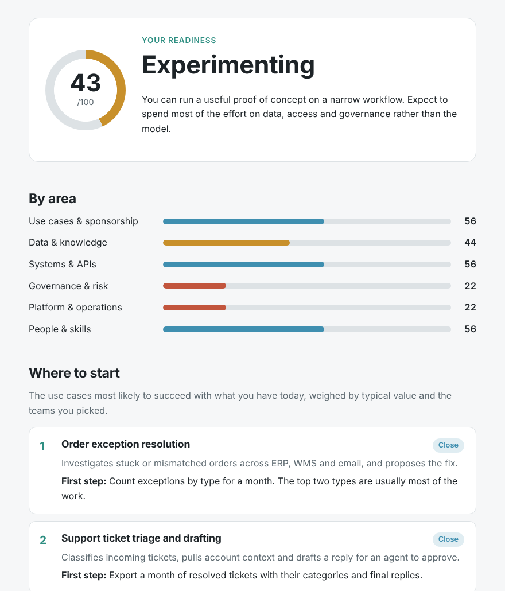

# Agent Readiness Scorecard

A five-minute self-assessment for teams thinking about AI agents. Answer 18 multiple-choice questions and
you get:

- a readiness score across six areas: use cases, data, systems, governance, platform and people
- the agent use cases most likely to work for you **now**, ranked against your answers
- the two or three things to fix first

It's a static page. There is no backend, no analytics and no sign-up. Answers are encoded in the URL hash,
so a result can be bookmarked or shared as a link, and nothing ever reaches a server.

**Try it:** https://yashodhantek.github.io/agent-readiness-scorecard/



## Why

Most agent projects that stall don't stall on the model. They stall because the data isn't where anyone
thought, the agent can't get a scoped service account, or security sees it for the first time a week before
launch. We wanted something quick a team could fill in before a kickoff to have that conversation early.

The questions come from the issues we run into most often when taking agents from pilot to production.
They're opinionated. Disagree in an issue.

## How the scoring works

Each answer scores 0-3. An area's score is its average as a percentage, and the overall score is the mean of
the six areas.

| Overall | Level |
|---|---|
| 0-24 | Exploring |
| 25-49 | Experimenting |
| 50-74 | Ready to pilot |
| 75-100 | Ready to scale |

Each use case in [`src/data/usecases.js`](src/data/usecases.js) lists the minimum level it needs in the areas
that matter for it (for example, contract review needs strong governance and people readiness). The ranking
multiplies:

- **value**: a rough 1-5 estimate of what the use case is worth when it works
- **fit**: how much of what it needs is already in place
- **relevance**: whether it belongs to a team you selected
- a small boost if it's common in your industry

Anything more than three-quarters of a level short is shown as "shore up first". It's a heuristic, not a
maturity model, and it doesn't replace talking to the people who do the work.

## Run it locally

No build step and no dependencies.

```
git clone https://github.com/yashodhantek/agent-readiness-scorecard
cd agent-readiness-scorecard
npm start          # serves on http://localhost:8000 (or: python3 -m http.server)
npm test           # node's built-in test runner, Node 18+
```

It has to be served over HTTP because browsers won't load ES modules from `file://`.

## Make it yours

Everything you're likely to change is plain data:

- [`src/data/questions.js`](src/data/questions.js): areas, questions, answers, advice for each score band,
  industries and teams
- [`src/data/usecases.js`](src/data/usecases.js): the use-case catalogue and what each one needs
- [`src/styles.css`](src/styles.css): colours are CSS variables at the top

The tests check that the data stays consistent (four answers per question, use cases only referencing areas
and teams that exist, and so on), so run `npm test` after editing.

If you change the questions, bump the `v1` prefix in `encodeState`/`decodeState` in
[`src/scoring.js`](src/scoring.js) so old shared links don't decode into the wrong answers.

## Deploying

The included workflow publishes to GitHub Pages on every push to `main`. Turn it on under
**Settings → Pages → Source: GitHub Actions**. Any static host works too: upload the repository as is.

## Contributing

Suggestions for questions and use cases are the most useful contribution. Please include why you think the
question separates teams that succeed from teams that don't. See [CONTRIBUTING.md](CONTRIBUTING.md).

## License

MIT. Use it internally, fork it, put your logo on it.

---

Built by [YashodhanTek](https://yashodhantek.com). If your score says "ready to pilot" and you want help
picking the first workflow, [get in touch](https://yashodhantek.com/contact/).
